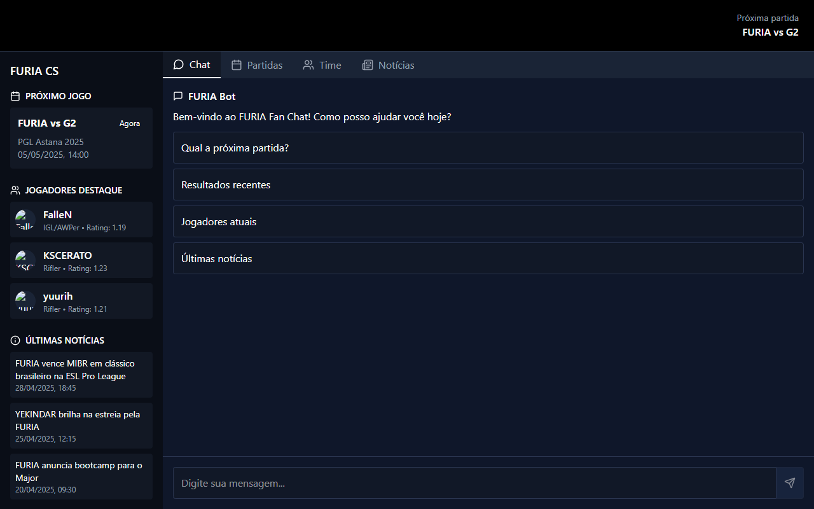

# FURIA Fan Chat

A conversational web app for fans of FURIA's Counter-Strike team: ask a chatbot about upcoming matches, recent results, the roster and news, or browse the same information in dedicated tabs.

Built for FURIA Tech's technical challenge #1, *Conversational Experience*, as part of a software engineering selection process.

**[Live demo →](https://furia-fan-chat-pi.vercel.app)**



## Features

- **Chatbot with quick replies.** Free-text questions are matched by keyword; suggested options cover next match, recent results, roster and news. Unknown questions get a fallback with the available topics.
- **Four tabs.** Chat, Matches (past and upcoming), Team (player cards with role and rating) and News.
- **Match details.** Per-match view with the map, player stats (K/D, ADR, rating) and a highlights link.
- **Responsive layout.** A collapsible sidebar keeps the chat usable on small screens.

> Match, player and news data are mocked (`src/data/mockData.js`) to keep the challenge self-contained; `src/services` is the seam where a real data source such as HLTV would plug in.

## Stack

React 19 · Vite · Tailwind CSS 4 · React Router · Lucide icons

## Running locally

```bash
git clone https://github.com/gabrielmds0/FuriaFanChat.git
cd FuriaFanChat
npm install
npm run dev        # http://localhost:5173
```

## Project structure

```
src/
├── components/   Chat, Sidebar, MatchCard, MatchDetails, PlayerCard, NewsCard, Header
├── services/     chatService (bot replies), hltvService (dates, countdowns), matchDetailsService
├── data/         mockData: matches, players, news and chatbot responses
└── App.jsx       tab layout
```
